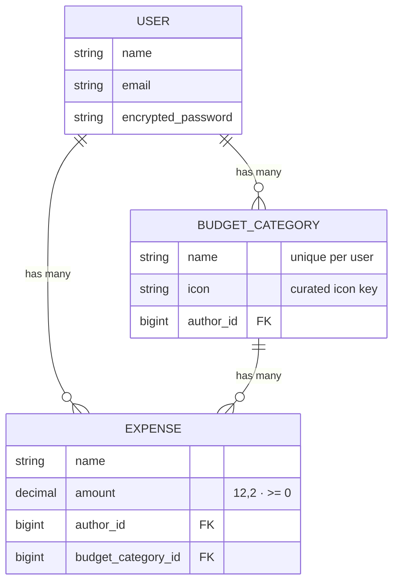

# 💸 Budget App

A clean, mobile-first Ruby on Rails app for tracking expenses by category.
Sign up, create spending categories with icons, log expenses against them, and
see exactly where your money goes — including a spending-by-category breakdown.

## Features

- **Authentication** with Devise (sign up, log in, password reset, profile editing)
- **Per-user data isolation** — every query is scoped to the signed-in user
- **Categories with a curated icon picker** (no more pasting image URLs)
- **Expense tracking** with precise decimal money and per-category totals
- **Dashboard** with total spent, category cards, and a spending-by-category bar chart
- **Mobile-first responsive UI** built on a custom CSS design system (no CSS framework)
- **Hotwire** (Turbo + Stimulus) with import maps — no Node.js build step

## Tech stack

| Layer | Choice |
|---|---|
| Framework | Ruby on Rails 7.0 (Ruby 3.1.2) |
| Database | PostgreSQL |
| Auth | Devise 4.9 |
| Frontend | Hotwire (Turbo/Stimulus), import maps, hand-rolled CSS design system |
| Tests | RSpec, Capybara |
| Linting | RuboCop (rails + rspec plugins) |

## Entity relationship diagram



## Getting started

### Prerequisites

- Ruby 3.1.2
- PostgreSQL 12+ running locally
- Bundler

### Setup

```bash
git clone https://github.com/milen-ale/Budget-app.git
cd Budget-app
bundle install

# Point the app at your Postgres instance (or edit config/database.yml)
bin/rails db:create db:migrate db:seed

bin/rails server
```

Then open http://localhost:3000.

The seeds create a demo account: **demo@example.com** / **password123**.

## Running tests

```bash
bundle exec rspec
```

The suite covers models (validations, totals, ownership rules), requests
(including authorization regression tests — users can never read or modify
another user's data), and a full sign-up → category → expense system flow.

## Linting

```bash
bundle exec rubocop
```

## Future improvements

- Monthly budgets per category with progress indicators
- Date-range filtering and monthly summaries
- CSV export
- Turbo Streams inline editing for expenses

## License

MIT
